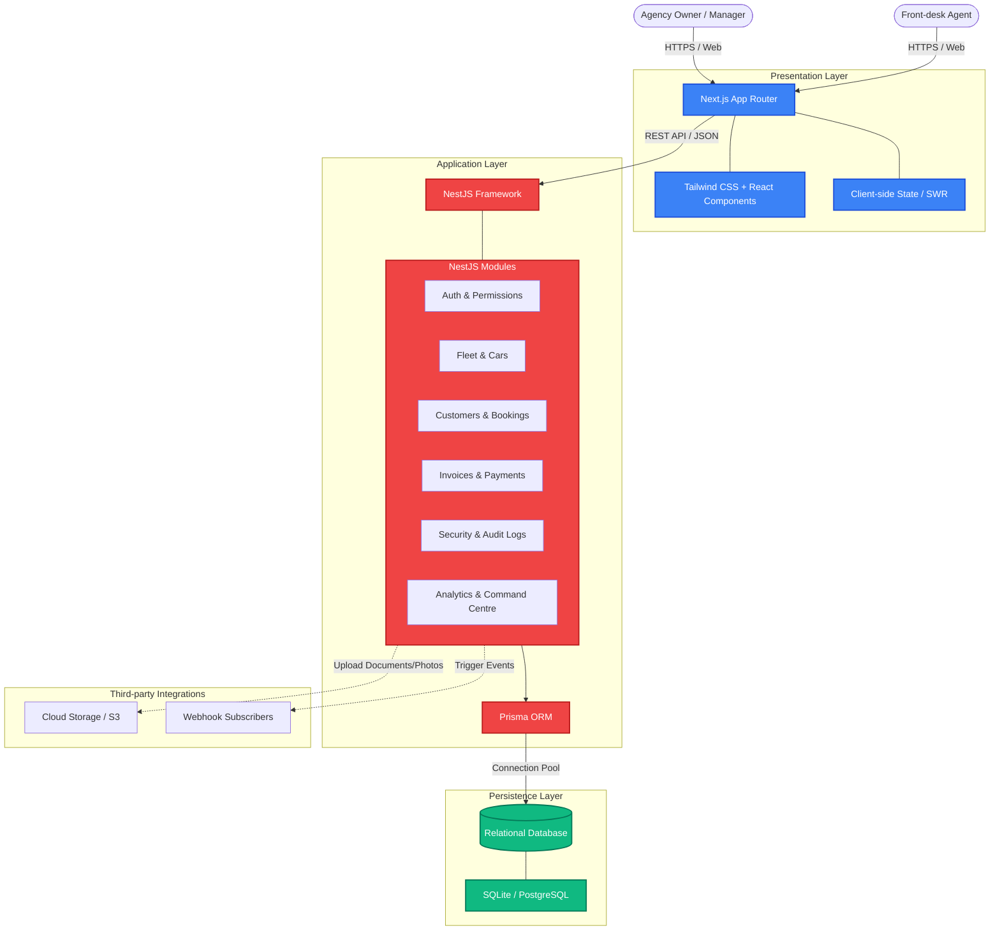
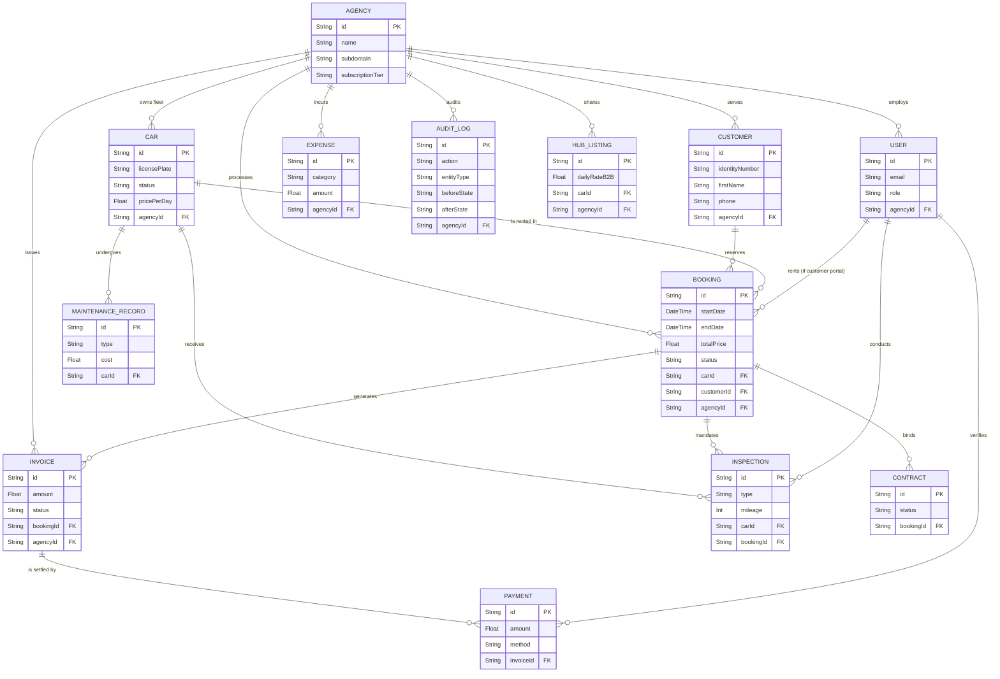

# 🚗 CarHub (Titan ERP Console)
## Architecture & Product Vision

---

### 1. Executive Summary & Product Vision

**CarHub** (internally recognized as the *Titan ERP Console*) is a comprehensive, multi-tenant SaaS Enterprise Resource Planning (ERP) platform explicitly engineered for car rental agencies. 

For decades, the car rental industry has relied on fragmented systems, relying heavily on messy Excel spreadsheets, disjointed paper trails, and a combination of isolated tools to track vehicles, bookings, and finances. This operational chaos leads to missed maintenance schedules, uncollected payments, vehicle damage disputes, and untracked expenses.

**The Core Value Proposition:**
CarHub transforms these chaotic workflows into a **centralized, automated, and intelligent command center**. By migrating agencies to CarHub, owners gain real-time visibility into their fleet's ROI, predictive alerts for maintenance and documentation renewals, strict security auditing, and streamlined financial controls. It empowers rental businesses to scale efficiently, minimize risks, and maximize fleet utilization through a singular, cohesive digital experience.

---

### 2. High-Level System Architecture

The CarHub platform adopts a modern, decoupled architecture designed for high performance, scalability, and strict tenant isolation.

**Architecture Stack Breakdown:**
* **Frontend:** Next.js (App Router) heavily leveraging React Server Components for performance, combined with Tailwind CSS for rapid, unified styling across the dashboard.
* **Backend:** NestJS, providing a robust, modular architectural pattern with built-in dependency injection, DTO validation, and strict type-safety via TypeScript.
* **Data Access:** Prisma ORM, enabling type-safe database queries and automated migrations.
* **Database:** Designed to be agnostic (currently SQLite for rapid development/edge deployments, scaling easily to PostgreSQL for massive concurrent workloads).

---

### 3. Core Business Domains & Features

The platform is strictly divided into five principal domains that govern the agency's lifecycle.

#### 📊 Command Centre (Analytics)
The central intelligence hub of the operation. This module aggregates data across all other domains to provide high-level, actionable insights. 
* **Capabilities:** Real-time calculation of Fleet Utilization, Revenue metrics, expense leakages, and per-vehicle Return on Investment (ROI) tracking.

#### 🚘 Fleet Management & Maintenance (The Guardian)
Dedicated to protecting the agency's primary assets. It provides granular tracking of every vehicle in the fleet.
* **Capabilities:** Tracking physical location/status of cars, logging historical maintenance, predicting next service intervals (e.g., Vidange), and actively monitoring expiring documents like Insurance and Technical Inspections to prevent operational blocks.

#### 🤝 CRM & Bookings
The operational heart for day-to-day business. This manages the delicate relationship between the vehicles, time, and the clients.
* **Capabilities:** Registering customer profiles, securely storing identity documents (CIN, Passports), managing active/upcoming/historical rentals, executing vehicle inspections (pre and post-rental), and issuing dynamic digital contracts.

#### 💰 Financial Vault
The ledger that tracks the lifeblood of the agency.
* **Capabilities:** Issuing automated invoices, tracking multi-method payments (Cash, Transfer, Card), managing rental deposits, and logging operational expenses (salaries, rent, utilities) to generate true net-profit reports.

#### 🛡️ Security & Auditing
The invisible watchdog. In a multi-user environment, accountability is paramount.
* **Capabilities:** The **AuditLog** system silently records every critical action (creating a booking, changing a vehicle's price, deleting records). It captures the `actor`, the `action`, and the exact `before` and `after` states in JSON format, preventing internal fraud.

---

### 4. Entity-Relationship Diagram (ERD)

The Prisma Schema is constructed with strict referential integrity and multi-tenant isolation (`Agency` acts as the root tenant for almost all records).

---

### 5. The Future Roadmap (The Upgrades)

While CarHub excels at operational management within a single agency, the overarching vision spans beyond isolated tenants.

#### Global Client Reputation & Blacklist Network 🌍
Currently, agencies operate in silos. If a customer damages a vehicle, steals parts, or refuses to pay at Agency A, there is no way for Agency B to know the risk before handing over their keys.

**The Upgrade:**
CarHub will introduce an opt-in **Global Client Reputation Network**. 
* **Mechanics:** While tenant data remains strictly isolated for privacy, standardized hashing of identity numbers (e.g., CIN/Passport) combined with an encrypted incident ledger will allow agencies to flag high-risk individuals.
* **Outcome:** When a customer attempts to book a vehicle at a new agency, the Command Centre will query the network using the hashed identity document. If the individual holds a severe penalty or is blacklisted across the Hub network, the system will instantly alert the front-desk agent, effectively protecting the fleet against repeat offenders across the entire region.
* **The B2B Hub Network:** Leveraging the `HubListing` infrastructure, the platform will also allow trusted agencies to cross-rent idle fleet inventory to one another during peak seasons, maximizing industry-wide utilization securely.
