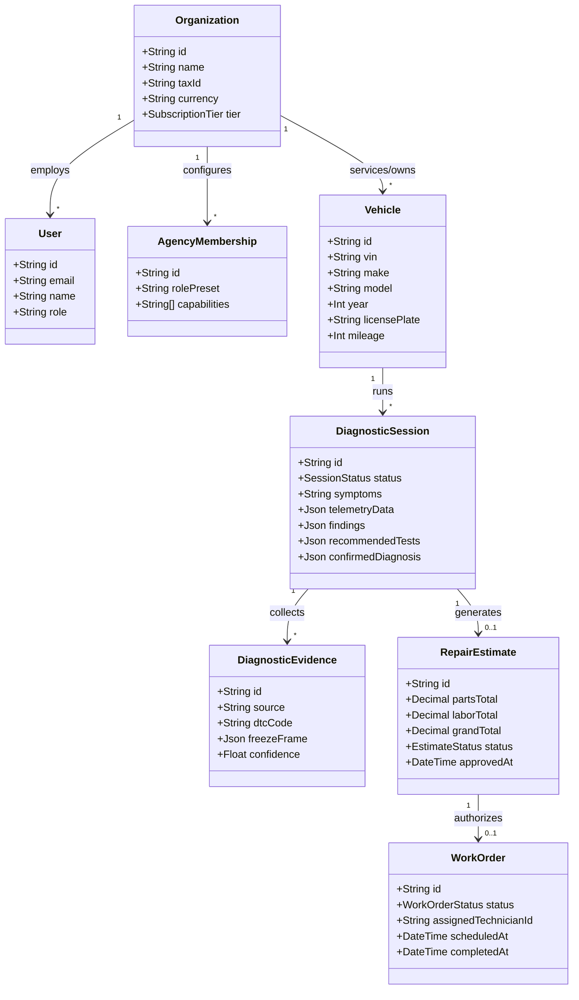

# CarHub OS — Domain Model & Entity Blueprint

This document defines the core domain boundaries, entities, relationships, state machines, and operational invariants for CarHub OS.

---

## 1. Core Domain Boundaries



---

## 2. Entity Catalog & Responsibilities

### A. Tenancy & Staff
1. **Agency / Organization (`Agency`)**: Primary multi-tenant boundary. Enforces localized settings, tax identifiers (ICE/taxId), operating currency (MAD), and billing subscriptions.
2. **User (`User`)**: System identities across platform tiers (`ROOT_ADMIN`, `OWNER`, `MANAGER`, `AGENT`, `RENTER`).
3. **AgencyMembership (`AgencyMembership`)**: Granular, per-tenant capability sets (`capabilities: String[]`) mapped to customizable role presets.
4. **Capabilities Matrix**:
   - `diagnostics.view`: Read sessions, telemetry graphs, and findings.
   - `diagnostics.perform`: Ingest telemetry, execute rules engine, trigger AI reasoning.
   - `diagnostics.confirm`: Sign off on root-cause fault hypotheses.
   - `diagnostics.estimate`: Generate parts/labor estimates and quotes.
   - `work_order.manage`: Progress work orders through shop state machine.
   - `inventory.manage`: Manage parts stock, suppliers, and procurement.

### B. Fleet & Automotive Assets
5. **Vehicle (`Car` / `DiagnosticVehicle`)**:
   - Physical vehicle attributes: VIN, Brand, Model, Year, Fuel Type, Gearbox, License Plate, Mileage.
   - Telemetry links: Supported PIDs, last known odometer, diagnostic history.
   - Fleet link: Optional association with commercial rental/fleet management assets.

### C. Diagnostic & Telemetry Domain
6. **DiagnosticSession (`DiagnosticSession`)**:
   - Lifecycle: `OPEN` $\rightarrow$ `ANALYZING` $\rightarrow$ `REVIEW_REQUIRED` $\rightarrow$ `CONFIRMED` $\rightarrow$ `ESTIMATED` $\rightarrow$ `CLOSED`.
   - Payload: Symptoms, normalized OBD telemetry series, detected DTCs, freeze frames, AI diagnostic hypotheses, recommended tests, confirmed fault.
7. **Telemetry Samples (`TelemetryEvent` / `Sample`)**:
   - Key PIDs: Engine RPM, Vehicle Speed, Coolant Temp, Intake Temp, MAF, MAP, STFT/LTFT, O2 Voltages, Throttle Position, Engine Load, Fuel Rail Pressure, Battery Voltage.
8. **DTC Events (`DTCEvent`)**:
   - Code standard: SAE J2012 (e.g. `P0300`, `P0171`, `P0420`, `U0100`).
   - Metadata: Status (`CURRENT`, `PENDING`, `HISTORICAL`), freeze-frame parameters, severity urgency (`CRITICAL`, `WARNING`, `ADVISORY`).
9. **Diagnostic Finding & Evidence**:
   - Root-cause hypothesis generated from rule synthesis and AI reasoning.
   - Probability score (`0.0` - `1.0`) and confidence classification.
   - Provenance trail: Timestamp, prompt version, input evidence hash, model ID.

### D. Repair Operations & Work Orders
10. **RepairRecommendation**: Recommended mechanical procedures (e.g., "Replace Ignition Coil Pack 1", "Clean Mass Airflow Sensor").
11. **PartsMatching & SupplierCatalog**:
    - OEM Part Numbers, Aftermarket equivalents, manufacturer brand, supplier cost, customer price, in-stock quantity.
12. **RepairEstimate**:
    - Itemized breakdown: Parts line items, Labor hours $\times$ shop hourly rate, Shop supplies, Moroccan VAT (20%).
    - Customer approval state machine: `DRAFT` $\rightarrow$ `PENDING_APPROVAL` $\rightarrow$ `APPROVED` $\rightarrow$ `DECLINED` $\rightarrow$ `EXPIRED`.
13. **WorkOrder (`WorkOrder`)**:
    - Shop floor operational tracking: assigned mechanic, bay number, work steps checklist, parts requisitioned, parts received, quality control sign-off.
    - Post-repair verification: clearing DTCs, road test re-scan, verification checklist.

---

## 3. Work Order State Machine

```
[ DRAFT ]
   │
   ▼
[ AWAITING_APPROVAL ] ──(Customer Declines)──> [ CANCELLED ]
   │
   ▼ (Customer Approves)
[ APPROVED ]
   │
   ▼
[ SCHEDULED ]
   │
   ▼
[ IN_PROGRESS ] ──(Missing Parts)──> [ WAITING_FOR_PARTS ]
   │                                         │
   │ <──────────(Parts Received)─────────────┘
   ▼
[ BLOCKED ] (Internal Issue / Escalation)
   │
   ▼
[ READY_FOR_QC ]
   │
   ▼
[ QUALITY_CHECK ] (DTC Re-Scan & Road Test Verified)
   │
   ▼
[ COMPLETED ]
   │
   ▼
[ INVOICED ]
```

---

## 4. Invariants & Rules of the Domain

1. **Evidence Grounding:** An AI diagnosis without supporting telemetry, DTCs, or explicit physical symptoms is rejected by validation.
2. **Technician Primacy:** AI cannot directly commit a repair order; a licensed technician must review and confirm the diagnosis.
3. **Audit Immutability:** Any modification to a confirmed diagnosis or approved estimate creates an immutable `AuditLog` row with before/after state diffs.
4. **Tenant Isolation:** All lookups enforce `where: { id, agencyId }`. Attempted cross-tenant access returns 404.
5. **Money Integrity:** All calculations use `Prisma.Decimal` or `Decimal.js`. No raw JS numbers for currency values.
