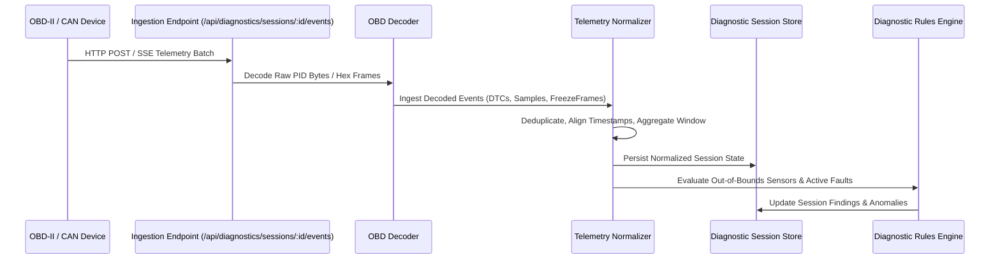

# CarHub OS — Telemetry & OBD-II Architecture

This document specifies the real-time telemetry streaming, ingestion, decoding, normalization, and simulation subsystems of CarHub OS.

---

## 1. Streaming & Ingestion Flow

---

## 2. Supported Standard PIDs & Metric Units

The CarHub normalizer standardizes all incoming vehicle sensors into metric SI units:

| Parameter ID (PID) | Standard Unit | Normalization Rule | Description |
|---|---|---|---|
| `0x0C` Engine RPM | RPM | $0 - 10,000$ RPM | Crankshaft rotational speed |
| `0x0D` Vehicle Speed | km/h | $0 - 300$ km/h | Road speed |
| `0x05` Coolant Temp | °C | $-40 - 150$ °C | Engine coolant temperature |
| `0x0F` Intake Air Temp | °C | $-40 - 100$ °C | Air temperature at intake |
| `0x10` MAF Air Flow | g/s | $0 - 500$ g/s | Mass air flow sensor rate |
| `0x0B` Intake MAP | kPa | $10 - 255$ kPa | Manifold absolute pressure |
| `0x06` STFT Bank 1 | % | $-100\% - +99.2\%$ | Short term fuel trim |
| `0x07` LTFT Bank 1 | % | $-100\% - +99.2\%$ | Long term fuel trim |
| `0x14` O2 Sensor Bank 1 | V | $0.0 - 1.2$ V | Upstream oxygen sensor voltage |
| `0x11` Throttle Position | % | $0 - 100\%$ | Relative throttle pedal opening |
| `0x04` Engine Load | % | $0 - 100\%$ | Calculated engine load value |
| `0x42` Control Voltage | V | $8.0 - 16.0$ V | Battery / Alternator system voltage |

---

## 3. Deterministic Simulator

CarHub OS includes a deterministic simulator to support end-to-end automated testing and garage demonstration without requiring a physical vehicle connection.

### Scenarios
1. **Normal Idle (`IDLE`)**:
   - RPM: 750-800, Coolant: 90°C, STFT: 0%, LTFT: +1%, O2: cycling between 0.1V and 0.85V.
2. **Cylinder 1 Misfire (`MISFIRE_CYL1`)**:
   - Active DTC: `P0301`.
   - Telemetry: Erratic RPM dip at idle, elevated STFT (+14%), rough engine load oscillations.
3. **System Too Lean Bank 1 (`LEAN_BANK1`)**:
   - Active DTC: `P0171`.
   - Telemetry: High LTFT (+22%), low upstream O2 voltage (<0.15V constant), elevated MAF error.
4. **Catalytic Converter Deterioration (`CATALYST_P0420`)**:
   - Active DTC: `P0420`.
   - Downstream O2 sensor mirrors upstream sensor oscillation (indicates loss of catalyst oxygen storage).
5. **Coolant Overheating (`OVERHEATING`)**:
   - Coolant temp climbing above 115°C, high engine load, radiator fan failure indicator.
