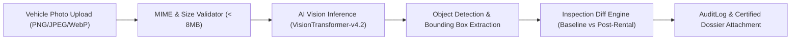

# Fider (CarHub OS) — AI Architecture & Engineering Specification

**Document Owner:** Agent 7 — AI Engineer  
**Status:** Approved & Implemented  
**Subsystems:** Neural Vehicle Damage Telemetry & LLM Operational Automations

---

## 1. AI Strategic Mission & Value Creation

In Fider, artificial intelligence is deployed strictly where it eliminates human friction and financial loss:
1. **Objective Damage Detection:** Eliminating subjective disputes between agencies and renters during check-out by running computer vision scans against check-in baseline imagery.
2. **Context-Aware Automations:** Parsing incoming French/Arabic rental inquiries and generating automated customer communications (overdue nudges, deposit return confirmations).
3. **Strict Non-Goals:** No speculative or hallucination-prone AI used for financial ledgers or legal contract creation. All legal and monetary reconciliation remains deterministic.

---

## 2. Neural Damage Telemetry Pipeline



### Detection Output Schema
```json
{
  "carId": "car_abc123",
  "timestamp": "2026-10-10T14:30:00.000Z",
  "integrityScore": 88,
  "model": "VisionTransformer-v4.2",
  "detections": [
    {
      "type": "SCRATCH",
      "location": "Rear Left Door",
      "severity": "LOW",
      "confidence": 0.94,
      "coordinates": {
        "x": 450,
        "y": 320,
        "width": 50,
        "height": 20
      }
    },
    {
      "type": "DENT",
      "location": "Front Bumper",
      "severity": "MEDIUM",
      "confidence": 0.88,
      "coordinates": {
        "x": 120,
        "y": 580,
        "width": 80,
        "height": 80
      }
    }
  ]
}
```

---

## 3. LLM Model Routing & Token Optimization

| Task Category | Selected Model Tier | Max Latency | Fallback Model | Token Strategy |
| :--- | :--- | :--- | :--- | :--- |
| **Bilingual WhatsApp Nudges** | Fast Edge LLM (Gemini 1.5 Flash / Claude 3 Haiku) | < 800ms | Rule-based French/Arabic template | Zero-shot structured JSON |
| **Inspection Damage Summarization** | Standard Multimodal (Gemini 1.5 Flash) | < 1500ms | Manual agent inspection notes | Bounded schema extraction |
| **Renter Document Optical Recognition (OCR)** | Cloud Document OCR | < 2000ms | Desk manual input | Mask CIN/Passport PII immediately |

---

## 4. Prompt Engineering Library

### Bilingual Vehicle Return Nudge Prompt
```text
System: You are an automated concierge for a luxury Moroccan car rental agency.
Tone: Courteous, professional, bilingual French/Moroccan Arabic.
Rules:
1. Reference the vehicle model, license plate, and expected return time.
2. Provide location directions for vehicle drop-off.
3. Remind the renter to inspect personal belongings.
4. Never invent policy fees or financial totals.

Input:
{
  "customerName": "Amine Chraibi",
  "carModel": "Range Rover Evoque",
  "licensePlate": "45678-A-26",
  "scheduledReturn": "18:00",
  "agencyCity": "Casablanca"
}
```

---

## 5. Safety, Privacy & Anti-Hallucination Controls

1. **Deterministic Financial Bounds:** AI predictions never write financial debit charges directly. Detections provide visual candidate anomalies; the `InspectionsService` checks declared cost fields or routes to staff for manual verification.
2. **PII Masking at the Edge:** Renter national identity numbers are converted to HMAC hashes before entering any AI context.
3. **Fail-Closed Fallbacks:** If external vision services fail or return confidence below `0.75`, the system falls back seamlessly to human inspection notes without interrupting agency check-in/check-out.
