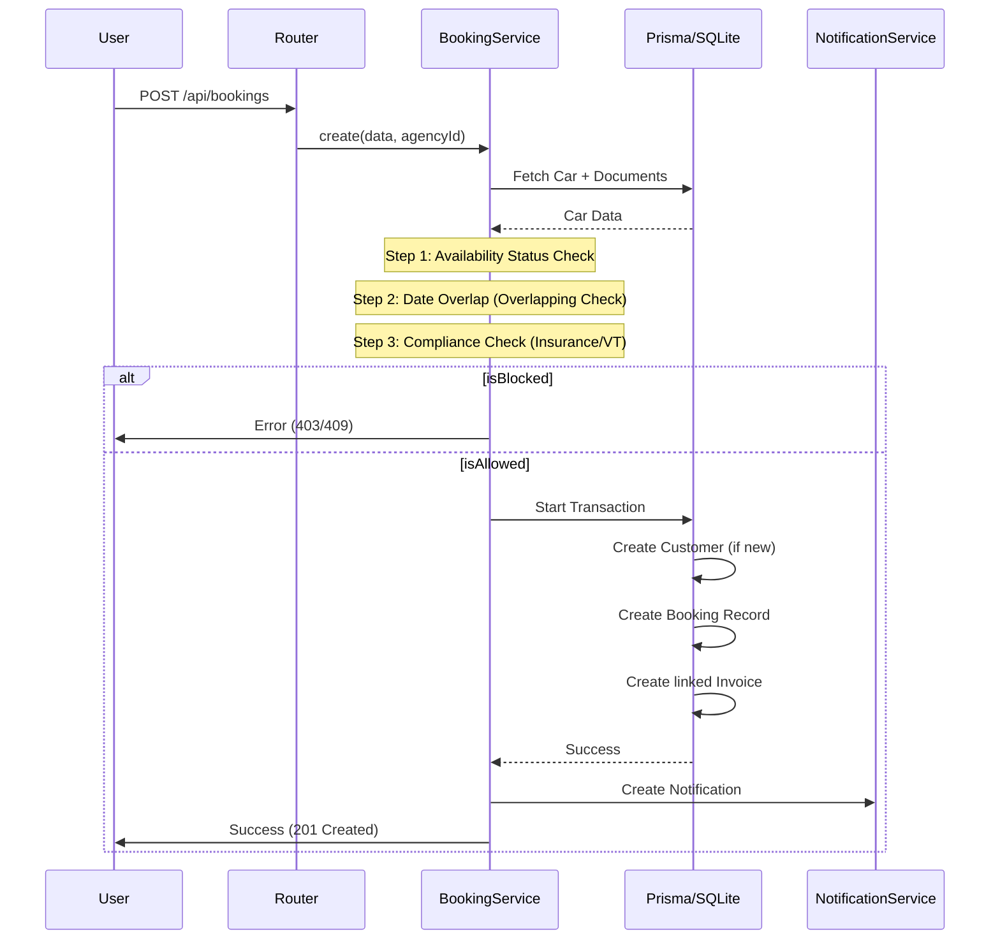
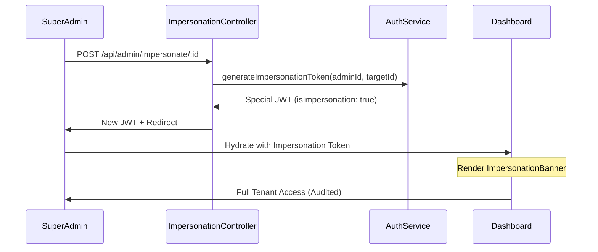
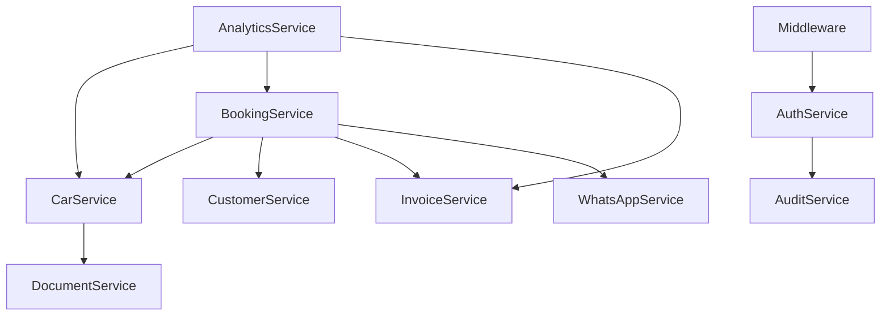

# THE ATOMIC BLUEPRINT: CarHub SaaS Operations Manual

**Project Maturity**: 🟢 Final Phase (Hardened & Atomic)  
**Document Purpose**: Definitive operational and technical record of all core platform logic.

---

## 1. 🔄 TRANSACTIONAL SEQUENCE DIAGRAMS

### 1.1 The "Booking-to-Compliance" Pipeline
This diagram illustrates the multi-stage validation performed during every booking attempt.



### 1.2 The "Forensic Impersonation" Handshake


---

## 🏗️ 2. SERVICE DEPENDENCY GRAPH
The backend uses a modular service layer where specialized services collaborate for transactional safety.



---

## 📊 3. THE "DATA DNA" REFERENCE (ATOMIC FIELDS)

| Model Attribute | Logic | Default / Behavior |
|:---|:---|:---|
| `Car.complianceScore` | Weighted (35/35/30) | Computed in `CarService` |
| `Booking.status` | State Machine | `PENDING` -> `ACTIVE` -> `COMPLETED` |
| `Invoice.status` | Billing logic | `DUE` -> `PAID` (triggered by Payment) |
| `AuditLog.diff` | Forensic Trace | JSON snapshot of previous/current data |
| `User.permissions` | RBAC Guard | Multi-level string (e.g. `OWNER`, `AGENT`) |

---

## ⚡ 4. PERFORMANCE HYDRATION LIFECYCLE
The frontend uses a sophisticated handshake to maintain performance and prevent flicker.

1. **Static Initial**: Next.js renders skeleton UI.
2. **Token Check**: `AuthContext` reads `autoflow_token` from `localStorage`.
3. **Identity Hydration**: `GET /api/auth/me` verifies identity.
4. **Memoized Context**: `AuthContext` stabilizes the environment using `useMemo`.
5. **Request Guard**: `DashboardPage` uses `useRef(hasFetched)` to block duplicate hydration calls.

---

## 🛡️ 5. FORENSIC ERROR SCHEMA (API RESPONSE)
Standardized error payloads for platform-wide consistency.

### Case: Conflict (409)
```json
{
  "status": "error",
  "message": "Date conflict with another booking.",
  "code": "BOOKING_CONFLICT",
  "forensicTrace": "32578e61-2775-43c2-b89a-a59107035d2f"
}
```

### Case: Forbidden Compliance (403)
```json
{
  "status": "error",
  "message": "Blocking: Insurance is missing or will expire during the rental period.",
  "code": "COMPLIANCE_HARD_BLOCK"
}
```

**This Atomic Blueprint documents the final structural and operational logic of the CarHub ecosystem.** **VOILA.** 🏎️💨
