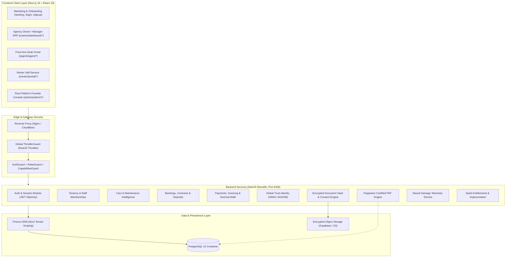

# Fider (CarHub OS) — System Architecture Document

**Document Owner:** Agent 2 — Software Architect  
**Status:** Approved & Implemented  
**Revision:** 4.2 (Production Release)

---

## 1. High-Level Architecture Diagram



---

## 2. Architectural Decision Records (ADRs)

### ADR-01: Multi-Tenancy Architecture — Shared Database, Shared Schema
- **Status:** Accepted
- **Context:** Car rental agencies range from boutique fleets (5 cars) to regional operations (150 cars). Dedicated databases per tenant would introduce high operational overhead and slow migrations.
- **Decision:** Shared PostgreSQL database with explicit tenant isolation via foreign key `agencyId` on all business records.
- **Enforcement:** All Prisma queries must resolve `agencyId` from the verified JWT `@CurrentUser()`. Unmatched or cross-tenant queries throw `NotFoundException` (404) to prevent IDOR scanning.

### ADR-02: Precise Monetary Mathematics — Decimal(12,2)
- **Status:** Accepted
- **Context:** Currency is Moroccan Dirham (MAD) with 20% inclusive VAT. Standard JavaScript IEEE 754 floating point arithmetic introduces rounding drift (e.g., `0.1 + 0.2 = 0.30000000000000004`), violating accounting reconciliation.
- **Decision:** All monetary columns use PostgreSQL `@db.Decimal(12,2)`. In NestJS services, all math is performed using the `Decimal.js` API (`.plus()`, `.minus()`, `.times()`, `.toDecimalPlaces(2)`), or compared in integer cents. The global `DecimalToNumberInterceptor` safely serializes Decimals to numbers at the HTTP boundary.

### ADR-03: Granular Capability-Based Access Control (CBAC)
- **Status:** Accepted
- **Context:** Role names like `AGENT` or `MANAGER` differ across agency organizations. Hardcoded role checks fail when an agency wants an agent to view financial reports without editing them.
- **Decision:** Replaced static role checking with a 21-capability engine mapped to `AgencyMembership`. Preset roles (`OWNER`, `MANAGER`, `AGENT`) initialize default capability arrays, which can be tailored per staff member. `ROOT_ADMIN` bypasses capability checks globally.

### ADR-04: Cross-Tenant Trust Identity Network via HMAC-SHA256
- **Status:** Accepted
- **Context:** Agencies need to share bad-renter intelligence without violating privacy laws (CNDP / Loi 09-08) or exposing client lists to competing agencies.
- **Decision:** Renter identity documents (CIN, Passport) are hashed server-side using `HMAC-SHA256` salted with a cluster-wide `IDENTITY_PEPPER`. Hashes allow deterministic cross-tenant risk scoring without storing or exposing plaintext credentials across agencies.

---

## 3. Directory & Module Boundaries

```
carhubos/
├── backend/
│   ├── src/
│   │   ├── auth/              # JWT issuance, cookie handling, password hashing
│   │   ├── agencies/          # Tenant lifecycle, subscription linking, soft delete
│   │   ├── agency-staff/      # Capability assignments, staff memberships
│   │   ├── cars/              # Fleet inventory, status state machine
│   │   ├── bookings/          # Availability check-then-act, deposit lifecycle
│   │   ├── contracts/         # Rental contracts, electronic signatures
│   │   ├── payments/          # Income/refund ledgers, Stripe/CMI checkout
│   │   ├── inspections/       # Pre/post rental condition diffing
│   │   ├── accidents/         # Incident reporting, claim tracking, dossier PDFs
│   │   ├── pdf-engine/        # Headless Chromium certified PDF generator
│   │   ├── trust/             # Cross-tenant HMAC identity scoring & blacklist
│   │   ├── consent/           # Renter Loi 09-08 consent grants
│   │   ├── vault/             # Encrypted document uploads & signed URLs
│   │   ├── ai-vision/         # Neural damage scanning & damage telemetry
│   │   ├── saas-admin/        # Founder metrics, tenant impersonation
│   │   └── common/            # Guards, interceptors, decorators, capabilities
│   └── prisma/                # Schema, migrations, deterministic seeds
└── frontend/
    ├── src/
    │   ├── app/
    │   │   ├── (public)/      # Landing page, login, signup
    │   │   ├── (owner)/       # Multi-section ERP dashboard
    │   │   ├── (agent)/       # Desk operations, quick check-in
    │   │   ├── (admin)/       # SaaS platform founder console
    │   │   └── (renter)/      # Self-service KYC & consent approval
    │   ├── components/ui/     # "Fider Lux" shared design system components
    │   ├── lib/               # Axios API client, formatting, contexts
    │   └── messages/          # Next-intl localized dictionaries (fr, ar, en)
```
