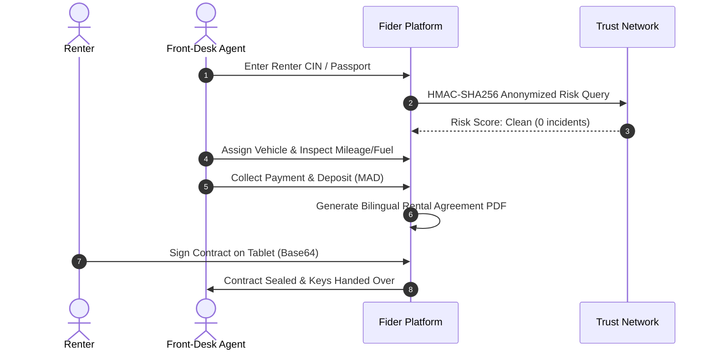
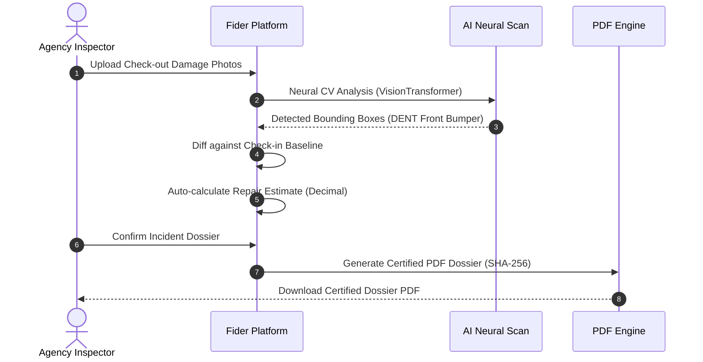

# Fider (CarHub OS) — UX/UI Design Specification

**Document Owner:** Agent 3 — UX/UI Designer  
**Design System Name:** *Fider Lux*  
**Core Design Philosophy:** Warm Graphite, High-End Hospitality, Calm Confidence, Instant Scannability

---

## 1. Design System Tokens & Foundations

The *Fider Lux* design system departs completely from generic, low-contrast "AI glassmorphism" in favor of an artisanal, editorial hospitality aesthetic suited for luxury automotive management.

### A. Color Palette Hierarchy

| Token Name | Semantic Purpose | Palette Value (HSL / CSS Var) | Notes |
| :--- | :--- | :--- | :--- |
| `--background` | Base Canvas | `hsl(240 5% 96%)` / Dark `hsl(240 6% 10%)` | Warm graphite / eggshell tint. Never `#000000` or `#FFFFFF`. |
| `--surface` | Container Surfaces | `hsl(0 0% 100%)` / Dark `hsl(240 5% 13%)` | Crisp card containers with 1px hairline border. |
| `--surface-raised` | Elevated Modals / Dropdowns | `hsl(240 5% 94%)` / Dark `hsl(240 5% 17%)` | Subtle layering without blurry backdrop filters. |
| `--primary` | Primary Brand Violet | `hsl(262 83% 58%)` | Restrained violet accent, high contrast for primary CTAs. |
| `--accent-brass` | Luxury Automotive Gold | `hsl(43 74% 49%)` | Used sparingly for VIP tags, verified badges, and active tiers. |
| `--text-foreground`| Primary Typography | `hsl(240 10% 4%)` / Dark `hsl(0 0% 98%)` | Maximum legibility. |
| `--text-muted` | Secondary Body Text | `hsl(240 4% 46%)` | Supporting details, metadata, captions. |
| `--border-hairline`| Subtle Divider | `hsl(240 6% 90%)` / Dark `hsl(240 4% 20%)` | 1px precision hairline borders. |

### B. Typography Invariants
- **Primary Body Font:** Inter / Hanken Grotesk (`font-sans`), clean geometric legibility.
- **Editorial Headings:** Fraunces serif accent (`font-display`) for high-end landing page titles and tier headers.
- **Data & Numbers:** JetBrains Mono / IBM Plex Mono (`font-mono`) with `tabular-nums` for VINs, license plates, invoice IDs, and MAD currency amounts.
- **Strict Invariant:** Zero usage of `font-black` (900 weight) across the entire codebase. Heading weights range strictly between `font-medium` (500) and `font-bold` (700).

---

## 2. Bilingual & Directional Adaptation (RTL / LTR)

To serve Moroccan agencies natively in French and Arabic:
- **Logical CSS Properties:** Layouts strictly employ logical CSS:
  - `ps-*` / `pe-*` instead of `pl-*` / `pr-*`
  - `ms-*` / `me-*` instead of `ml-*` / `mr-*`
  - `border-s-*` / `border-e-*` instead of `border-l-*` / `border-r-*`
  - `text-start` / `text-end` instead of `text-left` / `text-right`
- **Flex Direction & Icons:** Navigation arrows (`ChevronRight`), back buttons, and timeline steps automatically flip direction under `dir="rtl"`.

---

## 3. Core Component Library

```
frontend/src/components/ui/
├── Button.tsx         # 6 variants (primary, outline, ghost, danger, brass, link) with loading spin
├── Card.tsx           # Elevated hairline containers (Card, CardHeader, CardTitle, CardDescription)
├── Modal.tsx          # Accessible modal dialog with focus trapping and ESC escape
├── Combobox.tsx       # Type-ahead searchable dropdown for cars, customers, and locations
├── Badge.tsx          # Micro-pills for booking and car statuses (CONFIRMED, RENTED, MAINTENANCE)
├── Skeleton.tsx       # Calm shimmer placeholders (SkeletonCard, SkeletonTable)
├── EmptyState.tsx     # Expressive zero-data states with contextual action trigger
└── AgencyImage.tsx    # Optimized Next.js image wrapper with graceful fallback placeholder
```

---

## 4. User Journey Maps

### Journey 1: Front-Desk Check-In & Contract Signing


### Journey 2: Incident Reporting & Damage Claim

