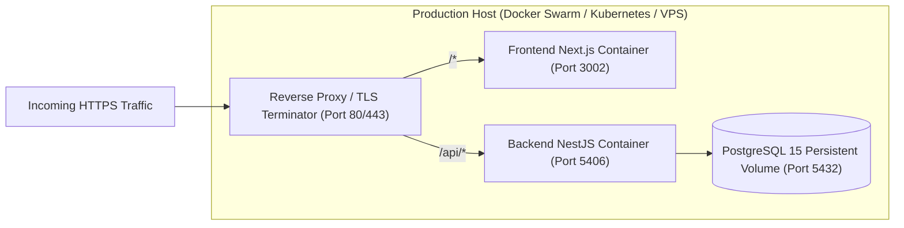

# Fider (CarHub OS) — DevOps, SRE & Deployment Guide

**Document Owner:** Agent 10 — DevOps / SRE Engineer  
**Status:** Production Ready  
**Target Environments:** Local Docker, Cloud Run / Fly.io, Self-Hosted VPS (Ubuntu 24.04 LTS)

---

## 1. Container Topology & Architecture



---

## 2. Environment Variables Catalog

| Variable Name | Required | Example / Default | Description |
| :--- | :--- | :--- | :--- |
| `DATABASE_URL` | Yes | `postgresql://fider:secret@db:5432/fider?schema=public` | PostgreSQL connection string with connection pooling. |
| `JWT_SECRET` | Yes | *64-character random hex string* | Symmetric key for signing session tokens in `infinity_token`. |
| `IDENTITY_PEPPER`| Yes | *64-character random hex string* | Immutable HMAC salt for hashing Moroccan CIN / Passports. |
| `PORT` | No | `5406` | Backend HTTP listening port. |
| `FRONTEND_URL` | Yes | `https://app.fider.ma` | Allowed origin for CORS and cookie domain matching. |
| `NEXT_PUBLIC_API_URL`| Yes | `https://app.fider.ma/api` | Client-side API baseUrl used by Axios. |
| `SUPABASE_URL` | Optional | `https://xyz.supabase.co` | Encrypted document vault storage bucket endpoint. |
| `SUPABASE_SERVICE_ROLE_KEY` | Optional | *service key* | High-privilege key for presigned document URL generation. |

---

## 3. Production Deployment Step-by-Step

### Step 1: Database Provisioning & Migrations
```bash
# Apply pending database schema migrations
cd backend
npx prisma migrate deploy

# Run idempotent reference data seeds (roles and subscription plans)
node -r dotenv/config prisma/seed-roles.js
node -r dotenv/config prisma/seed-plans.js
```

### Step 2: Backend Container Build & Start
```bash
# Build multi-stage optimized production image
docker build -t fider-backend:latest -f backend/Dockerfile .

# Start container with healthcheck
docker run -d \
  --name fider-backend \
  --restart unless-stopped \
  -p 5406:5406 \
  --env-file backend/.env \
  fider-backend:latest
```

### Step 3: Frontend Container Build & Start
```bash
# Build Next.js standalone container
docker build -t fider-frontend:latest -f frontend/Dockerfile .

# Start container
docker run -d \
  --name fider-frontend \
  --restart unless-stopped \
  -p 3002:3002 \
  --env-file frontend/.env \
  fider-frontend:latest
```

---

## 4. Health Checks & Observability

- **Backend Liveness Probe:** `GET http://localhost:5406/api/health`
  - Returns `200 OK` with `{ status: "ok", timestamp: "..." }`.
  - Used by container orchestrators (Kubernetes / Cloud Run) to restart unresponsive instances.
- **Database Connectivity Guard:** Prisma connection pool configured with 10s timeout to prevent thread starvation under load.
- **Log Aggregation:** JSON structured logging emitted to `stdout`/`stderr` for consumption by Fluentd, Datadog, or CloudWatch.

---

## 5. Rollback Procedures & Disaster Recovery

### Automated Backup Schedule
- Daily PostgreSQL `pg_dump` snapshot stored offsite in S3 with 30-day retention.
```bash
# Emergency restore procedure:
pg_restore -h db.fider.ma -U fider -d fider_restored < backup_20261010.dump
```

### Blue/Green Rollback Strategy
- In the event of a critical regression post-deployment:
  1. Re-route reverse proxy traffic to previous stable container tag `fider-backend:v4.1`.
  2. If a migration broke backwards compatibility, roll back the specific migration using `prisma migrate resolve --rolled-back`.
